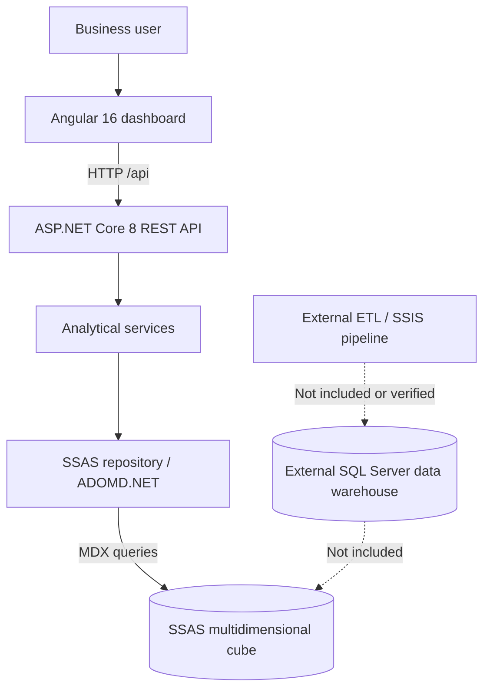

<div align="center">

# SalesPulse BI

### Multidimensional Sales Analytics Platform

**Explore sales performance through interactive dashboards powered by Angular, ASP.NET Core and SQL Server Analysis Services.**


[Overview](#overview) · [Features](#features) · [Architecture](#architecture) · [Getting started](#getting-started) · [API](#api-overview) · [Limitations](#project-status-and-limitations)

</div>

---

## Overview

**SalesPulse BI** is a full-stack Business Intelligence application for exploring commercial performance across multiple dimensions. It connects an Angular dashboard to an ASP.NET Core REST API, which queries a multidimensional **SQL Server Analysis Services (SSAS)** cube using **MDX** and **ADOMD.NET**.

The goal is to turn multidimensional sales data into useful business insights: revenue trends, product performance, customer rankings, geographical distribution and employee contributions.

> [!IMPORTANT]
> **This repository contains the application code, not the underlying BI infrastructure or data.** The original SSAS cube (`CUBE_EDB`), SQL Server data warehouse and SSIS/ETL projects are **not included**. No artificial demo sales data is bundled. The user interface and API can start without SSAS, but live KPIs and charts require access to a compatible cube.

## Features

| Module | What it provides |
| --- | --- |
| **Executive Dashboard** | KPI cards, sales evolution, product and employee rankings, geographical analysis and a top-customer table. |
| **Sales Analytics** | Time-based analysis and dimension/level selection for multidimensional exploration. |
| **Product Analytics** | Compare sales by product category, brand and individual product. |
| **Customer Analytics** | Examine customer segments, types, companies and individual customers. |
| **Geography Analytics** | Compare performance across countries and cities. |
| **Employee Analytics** | Explore results by department, job title and employee. |
| **Dimensions Explorer** | Inspect dimension members and their SSAS `MEMBER_UNIQUE_NAME` identifiers. |

**Additional capabilities**

- Interactive visualizations using **Chart.js** and reusable Angular UI components.
- Analysis of sales measures such as **total revenue, quantity sold, order count and average basket value**, depending on the measures available in the connected cube.
- Configurable dimension levels, measures and Top-N selections on supported analytics pages.
- REST endpoints with **Swagger/OpenAPI** in development mode.
- Explicit API and UI error reporting for failed analytical requests, instead of silently treating errors as valid empty charts.
- Separation of frontend, API controllers, analytical services and SSAS data access.

> **Drill-down note:** Exploration is implemented through dimension and hierarchy-level selectors; clicking directly on a chart segment does not currently trigger hierarchical drill-down.

## Tech stack

| Layer | Technologies | Responsibility |
| --- | --- | --- |
| Frontend | Angular 16, TypeScript, HTML, CSS, RxJS | Navigation, dashboard pages and API integration |
| Visualization | Chart.js 4 | Interactive charts and graphical summaries |
| Backend | C#, ASP.NET Core 8 | REST API, validation and analytical services |
| OLAP access | ADOMD.NET, MDX | Query execution and result mapping |
| Analytics engine | SQL Server Analysis Services (SSAS Multidimensional) | Cubes, dimensions, hierarchies and measures |
| Development | Swagger / OpenAPI, Git | API exploration and source control |

**SSIS and a SQL Server data warehouse are part of the expected upstream BI context, not deliverables included in this repository.**

## Architecture



A typical request follows this sequence:

1. The user opens an analytics page or selects a measure and hierarchy level.
2. Angular calls an `/api/...` endpoint through its local development proxy.
3. An ASP.NET Core controller delegates the request to an analytical service.
4. The service prepares an MDX query and accesses SSAS through ADOMD.NET.
5. The API returns structured data; Angular transforms it into charts, tables and KPI cards.

The cube schema expected by the application is described in [`backend/Constants/CubeDefinition.cs`](backend/Constants/CubeDefinition.cs). It includes date, product, customer, employee and geography dimensions.

For additional technical details, see [`docs/ARCHITECTURE.md`](docs/ARCHITECTURE.md).

## Repository structure

```text
SalesPulse-BI/
├── backend/
│   ├── Constants/              # Cube dimensions and measures
│   ├── Controllers/            # REST endpoints
│   ├── Middlewares/            # Centralized exception handling
│   ├── Models/                 # API request and response models
│   ├── Options/                # Configuration models
│   ├── Repositories/           # SSAS data access
│   ├── Services/               # Business and analytics logic
│   ├── appsettings.json
│   └── appsettings.Local.example.json
├── frontend/
│   ├── src/app/
│   │   ├── core/               # Models and HTTP services
│   │   ├── pages/              # Dashboard and analytics pages
│   │   └── shared/components/  # Charts, tables, KPI cards and navigation
│   ├── package.json
│   └── proxy.conf.json
├── docs/
│   ├── ARCHITECTURE.md
│   └── VALIDATION.md
├── CHANGELOG.md
├── LICENSE
└── README.md
```

## Getting started

### 1. Requirements

- **Windows** is the recommended development environment for the supplied SSAS connection approach (Windows integrated authentication / SSPI).
- **.NET SDK 8** for the backend.
- A Node.js version compatible with **Angular 16**. **Node.js 18.20.8** was used to start this legacy frontend locally; **Node.js 18 is end-of-life**, so use it only for compatibility with this version and plan an Angular/Node upgrade for long-term maintenance.
- npm (installed with Node.js).
- **To load actual analytics:** an accessible **SSAS Multidimensional** instance with the expected cube, measures and hierarchies, plus appropriate Windows permissions.

### 2. Clone the repository

```bash
git clone https://github.com/kammariem/SalesPulse-BI.git
cd SalesPulse-BI
```

### 3. Configure the backend

In **PowerShell**:

```powershell
cd backend
Copy-Item appsettings.Local.example.json appsettings.Local.json
```

Edit `backend/appsettings.Local.json` to reference **your own** SSAS instance:

```json
{
  "Ssas": {
    "ConnectionString": "Data Source=YOUR_SSAS_SERVER;Initial Catalog=YOUR_SSAS_DATABASE;Integrated Security=SSPI;",
    "CommandTimeoutSeconds": 120,
    "AllowRawMdxInDevelopment": false
  }
}
```

- `Data Source`: the SSAS server or named instance.
- `Initial Catalog`: the SSAS **database**, which may differ from the cube name.
- The MDX queries in this project reference a cube named **`CUBE_EDB`**. Check your cube schema against `CubeDefinition.cs` and the MDX queries in `appsettings.json`.
- `appsettings.Local.json` is deliberately ignored by Git. **Never commit real connection credentials or private server details.**

If no SSAS server is available, you can skip configuring a working connection, but analytics requests will not return live business data.

### 4. Start the ASP.NET Core API

From `backend/`:

```powershell
dotnet restore
dotnet run --launch-profile http
```

Local endpoints:

- **API:** http://localhost:5084
- **Swagger UI:** http://localhost:5084/swagger
- **API health:** http://localhost:5084/api/health
- **SSAS connection test:** http://localhost:5084/api/ssas/test

The health endpoint checks whether the **API is running**; it does **not** validate the SSAS connection. On the SSAS test endpoint, verify the `isConnected` field in the response.

### 5. Start the Angular frontend

Open a **second terminal** in the repository root:

```powershell
cd frontend
npm ci
npm start
```

Open **http://localhost:4200**.

Angular uses [`frontend/proxy.conf.json`](frontend/proxy.conf.json) to forward requests beginning with `/api` to **http://localhost:5084**.

> If you manage multiple Node.js versions with **FNM**, activate the compatible version before running npm: `fnm use 18.20.8` (after configuring FNM for that terminal).

## API overview

| Method | Endpoint | Purpose |
| --- | --- | --- |
| `GET` | `/api/health` | Check API availability |
| `GET` | `/api/ssas/test` | Check SSAS connection status |
| `GET` | `/api/dashboard/overview` | Executive dashboard data |
| `GET` | `/api/analytics/kpis` | Analytical KPI measures |
| `GET` | `/api/sales/trend` | Time-based sales series |
| `GET` | `/api/sales/drilldown` | Sales breakdown by axis and level |
| `GET` | `/api/products/performance` | Product performance |
| `GET` | `/api/customers/performance` | Customer performance |
| `GET` | `/api/geography/performance` | Geographical performance |
| `GET` | `/api/employees/performance` | Employee performance |
| `GET` | `/api/dimensions/members` | Members of a dimension hierarchy |

The API also provides metadata-related endpoints. Consult the local **Swagger UI** for the full route list and accepted query parameters.

## Troubleshooting

| Problem | Likely cause | What to check |
| --- | --- | --- |
| Angular shows `ECONNREFUSED` for `localhost:5084` | Backend is not running | Start `dotnet run --launch-profile http` from `backend/` |
| Angular compiles, but dashboard data is missing | SSAS unavailable or incompatible | Check `/api/ssas/test` and backend logs |
| `The SSAS connection string is empty` | Missing local configuration | Create `backend/appsettings.Local.json` from the example |
| `ng` is not recognized | npm dependencies were not installed successfully | Run `npm ci` from `frontend/`, with a compatible Node.js version |
| `npm ci` stalls or reports `ENOTFOUND` | Registry or network problem | Check `npm config get registry`, `npm ping` and the package lock's resolved URLs |
| MDX errors or missing measures | Cube schema does not match the application | Compare the target cube with `CubeDefinition.cs` |

## Project status and limitations

This repository is a **portfolio/academic project**, not a hosted demo or a complete deployable BI data platform.

- **Locally confirmed:** Angular development build completed and the ASP.NET Core API started successfully.
- **Not end-to-end verified:** live SSAS queries, KPI accuracy and complete dashboards, because the original cube environment is no longer available.
- **Not included:** SSIS packages, data warehouse schema/data, cube deployment files or populated sample datasets.
- **No mock dataset:** visualizations require real API responses from a compatible cube.
- **Performance:** some Top-N results are reduced after retrieving SSAS members. Large hierarchies may need additional query optimization.
- **Testing:** automated integration tests with an SSAS server are not part of this repository.
- **Maintenance:** Angular 16 and its associated Node.js 18 development setup are legacy versions and should be upgraded before production use.

Manual verification guidance is available in [`docs/VALIDATION.md`](docs/VALIDATION.md).

## Potential improvements

- [ ] Add authorized screenshots of the working dashboard and analytics pages.
- [ ] Provide a separately licensed **synthetic** BI dataset and reproducible cube setup.
- [ ] Introduce automated frontend and API tests.
- [ ] Optimize OLAP Top-N queries for large dimensions.
- [ ] Enhance chart-based drill-down and cross-page filtering.
- [ ] Upgrade Angular and align the project with supported Node.js versions.

## License

This repository includes an [MIT license](LICENSE). Refer to the `LICENSE` file for its copyright notice and terms.

---

<div align="center">

**SalesPulse BI** · Built to explore the intersection of full-stack development and Business Intelligence.

[Back to top](#salespulse-bi)

</div>
