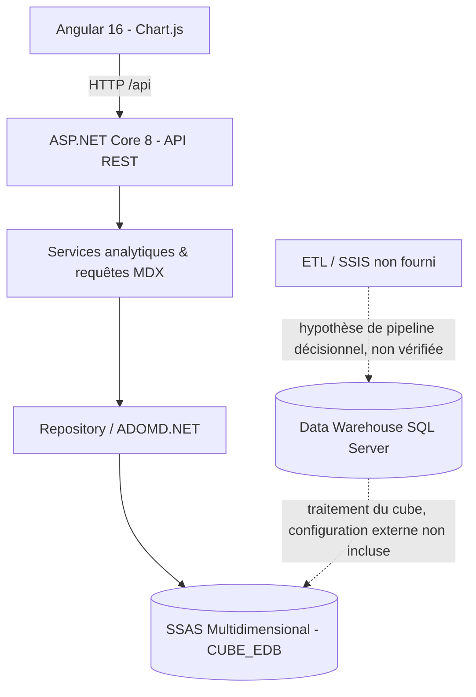

# Architecture de SalesPulse BI

La présence d'un Data Warehouse et d'un package SSIS n'est **pas prouvée** par ce dépôt. Les éléments en pointillés représentent un pipeline BI possible et non une fonctionnalité livrée.

## Flux d'une visualisation

1. L'utilisateur sélectionne une mesure et un niveau (Angular).
2. Le service Angular interroge une route REST de l'API .NET.
3. Le contrôleur transmet à un service analytique qui construit une requête MDX.
4. Le repository exécute cette requête via ADOMD.NET sur SSAS.
5. Les résultats sont mappés en DTO et présentés en KPI, graphique ou tableau.

## Points de configuration

- `backend/Constants/CubeDefinition.cs` : noms des dimensions et mesures SSAS (doivent correspondre au cube réel).
- `backend/appsettings.json` : configuration non sensible par défaut.
- `backend/appsettings.Local.json` : connexion spécifique à ton PC, à partir du modèle `appsettings.Local.example.json`.
- `frontend/proxy.conf.json` : routage de `/api` vers le port local `5084`.

## Points d'attention

- Le Top N côté C# peut augmenter la taille des résultats intermédiaires ; pour les gros cubes, envisager un `ORDER/HEAD` ou un `TOPCOUNT` MDX **après validation** sur la hiérarchie concernée.
- Les KPI calculés absents peuvent rester `null`, avec avertissements serveur. Les défaillances totales et les séries MDX en erreur produisent désormais un échec HTTP explicite.
- Aucun test d'intégration SSAS automatique n'est fourni car le cube ne figure pas dans l'archive.
